# Income Radar

A lightweight personal-finance app for Android, written in Rust.

* **UI:** [Slint](https://slint.dev) (native, GPU-rendered, no WebView, no JVM UI code)
* **Storage:** SQLite (bundled through `rusqlite`), stored on the device only
* **Design:** Bento Neo design system: 8 themes (Lime, Solar, Ember, Lilac × light/dark) plus the
  **Aurora Glass** style (frosted panels over a soft aurora, a little glow), Manrope font
* **APK size:** about 8 MB (single arm64 `.so`, release profile with LTO and `opt-level = "s"`)

| Home | Stats | New entry | Activity | Budgets | Light |
|---|---|---|---|---|---|
| 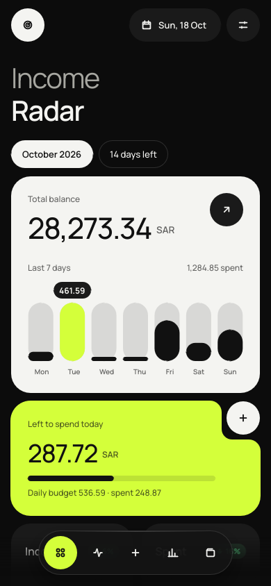 | 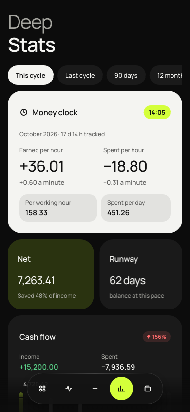 | 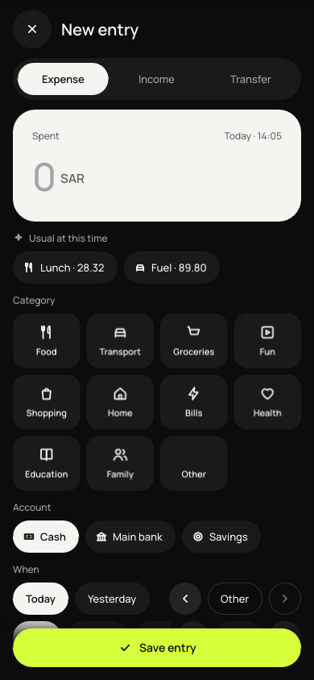 | 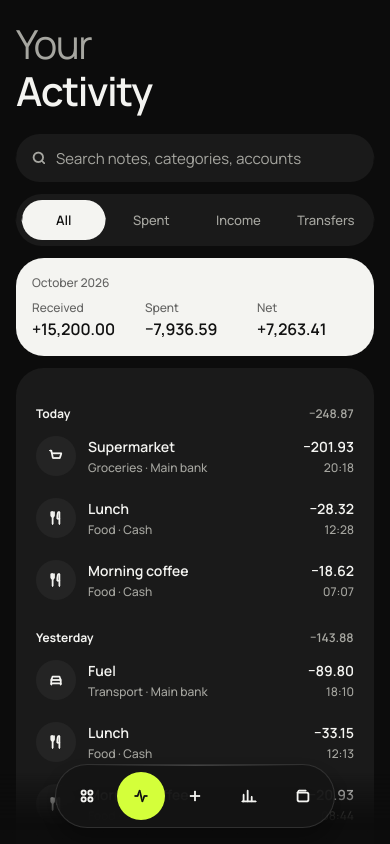 | 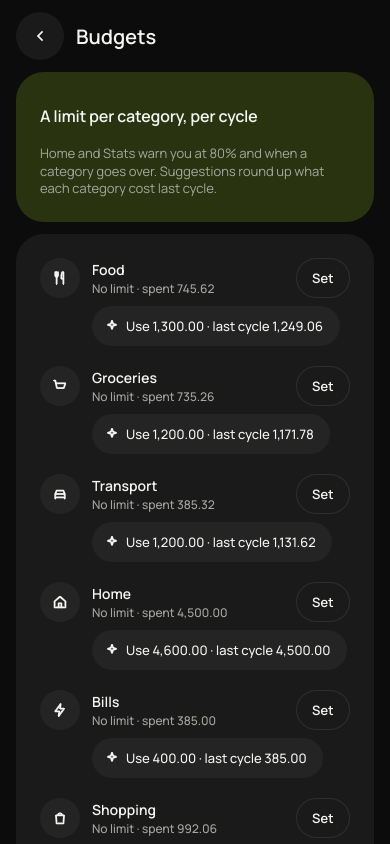 | 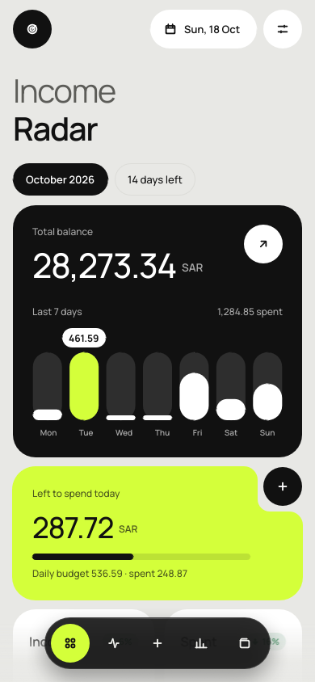 |

**Aurora Glass**

| Home | Stats | New entry | Activity | Budgets | Settings |
|---|---|---|---|---|---|
| 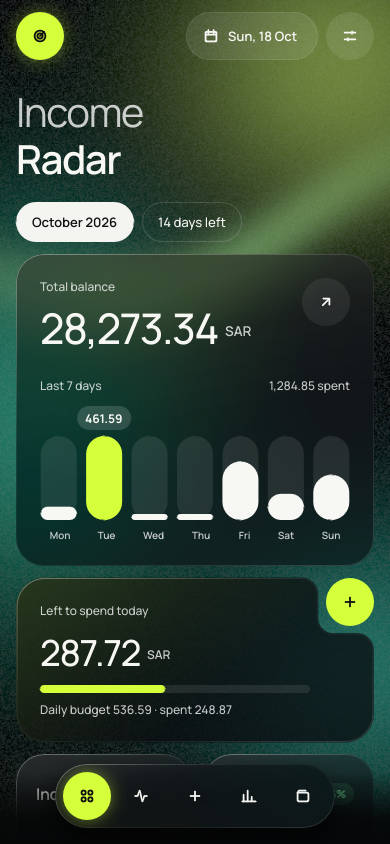 | 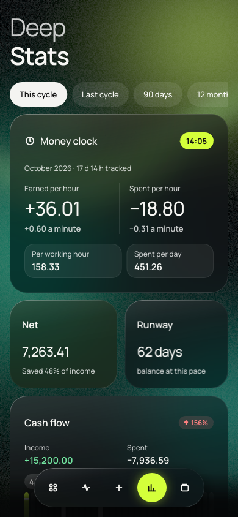 | 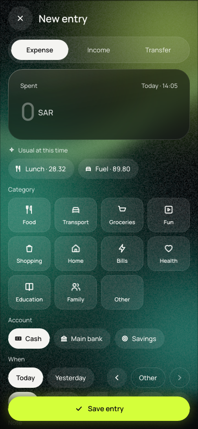 | 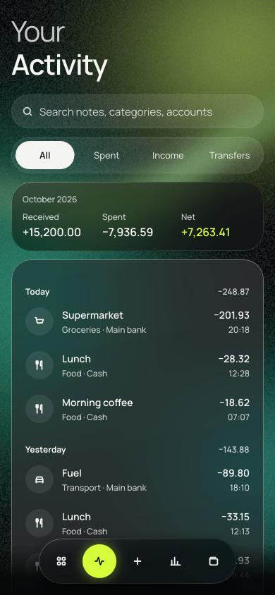 | 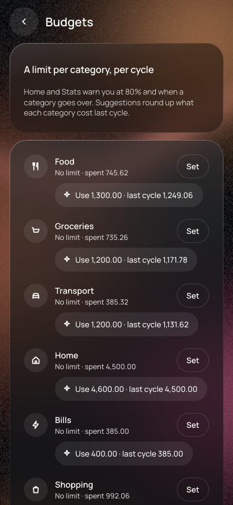 | 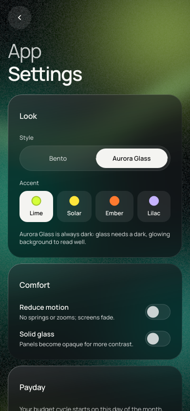 |

## What it does

* **Radar dashboard:** total balance, spending over the last 7 days, **left to spend today**
  (the day's allowance is fixed when the day starts, so it does not shift as you spend),
  income and spending against the previous cycle, savings rate, projected spending at the
  current pace (a one-off like rent does not blow up the forecast), and where the money goes.
* **Deep Stats, by the hour and the minute:** earned and spent per hour and per minute,
  per working hour, spent per day; cash-flow bars; purchases by hour; a 7 × 24 week × hour dot
  matrix; weekday vs. weekend (Fri–Sat or Sat–Sun, your choice); median and average purchase;
  time between purchases; no-spend streaks; runway; what a purchase costs in minutes of work;
  category shares with budgets; biggest purchases; written insights. Ranges: this cycle,
  last cycle, 90 days, 12 months.
* **Fast entry:** keypad first; **suggestions** for what you usually log at this time of day;
  category grid (every category one tap away); account chips; day and time to the minute with
  quick chips (1 h ago, 3 h ago, this morning, last night); the Save button stays pinned above
  the keyboard / navigation bar.
* **Edit, delete, undo, search,** transfers between accounts, **category budgets** with warnings.
* **Payday cycles:** the budget month starts on your payday (day 1–28).
* **Accounts:** balances are calculated from the ledger (opening + entries + transfers), never stored.
* **Money as integers:** amounts are stored in minor units (`i64`). Input accepts Arabic-Indic digits.
* **Private:** no account, no network permission, no ads.
* **Look:** Bento Neo, 8 themes, or **Aurora Glass** (Settings → Style). Glass panels sample a
  pre-blurred aurora drawn once on the CPU, so they look frosted without a live backdrop blur
  (Slint has none). A soft glow follows your finger. Text contrast is unit-tested against the
  brightest pixel behind every panel (WCAG AA). "Solid glass" turns the frost off.
* **Motion:** spring animations everywhere (interruptible, they keep their speed when you
  reverse them). The **+** button morphs into the entry page and back, like Apple's Magic Move.
  Tiles fade in one after another, the nav thumb and dock disc glide. **Reduce motion** in
  Settings turns it all to short fades.

## Tested like 100 real people

`app/examples/simulate.rs` drives the real UI (taps, scrolling, swipes, typing) for 100 simulated
people × 5 sessions, keeps a shadow ledger and checks every balance, plus statistics sums.
Latest run after the redesign: 60 of 100 people (stopped early), 1 unexpected problem,
still to be looked at. The last full run had 2 (budget saves), traced to the simulator tapping
while the page was still scrolling.
See [`docs/SIMULATION_REPORT.md`](docs/SIMULATION_REPORT.md) for what it found and what was fixed, and
[`docs/SIMULATION_RESULTS.md`](docs/SIMULATION_RESULTS.md) for the raw numbers.

```sh
SLINT_EMIT_DEBUG_INFO=1 cargo run -p income-radar --example simulate --release
```

## Layout

```
crates/core/   domain logic, no UI (money, cycles, SQLite store, radar analytics) + tests
app/           Slint UI and the Android / desktop entry points
  ui/theme.slint            Bento Neo tokens (all 8 themes, spacing, radii, type scale, icons)
  ui/components/bento.slint Tile, NotchCard, PillButton, IconButton, Chip, Badge, Progress,
                            Bars, DotMatrix, ListRow, PillNav, Dock (glass), Toast, Field
  ui/screens/               home, activity, stats, add, accounts, budgets, settings
  examples/simulate.rs      100 people × 5 sessions through the real UI
  src/lib.rs                UI ↔ store glue, `android_main`
  src/main.rs               desktop window and `--screenshots` mode
  android/res/              launcher icon
```

## Build

### Desktop (for development)

```sh
cargo run -p income-radar
cargo test --workspace
```

Linux needs the usual X11/Wayland libraries (`libxkbcommon-x11`, `libfontconfig`).

Screenshots of every screen, using sample data and a fixed date:

```sh
INCOME_RADAR_TODAY=2026-10-18 cargo run -p income-radar -- --screenshots docs/screenshots
```

### Android APK

Requirements: Android SDK (platform 35, build-tools 35), NDK r28, Java 17+, and

```sh
rustup target add aarch64-linux-android
cargo install cargo-apk
export ANDROID_HOME=/path/to/android-sdk
export ANDROID_NDK_ROOT=$ANDROID_HOME/ndk/28.2.13676358
```

Debug build, installed on a connected phone:

```sh
cargo apk run -p income-radar --lib
```

Release build. Use your own keystore and keep it out of the repository:

```sh
export CARGO_APK_RELEASE_KEYSTORE=/path/to/release.jks
export CARGO_APK_RELEASE_KEYSTORE_PASSWORD=...
cargo apk build -p income-radar --lib --release
# → target/release/apk/income-radar.apk
```

## Roadmap

* Recurring entries and subscription reminders
* Export and backup (CSV / encrypted file)
* Arabic UI with right-to-left layout (needs an Arabic font paired with Manrope)
* Savings goals, home-screen widget for quick entry
* Check on a real device: the app was built and verified on desktop and by simulation only
  (frame rate, battery and the glass look on a phone screen are not measured yet)
* Look into memory growth over 500 simulated sessions in one process and a ~2 s slowest tap

## Fonts

Manrope is licensed under the SIL Open Font License (`app/fonts/OFL.txt`).
