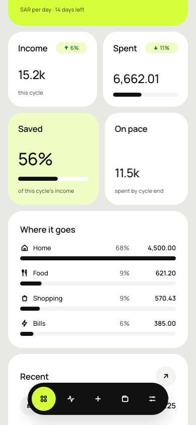
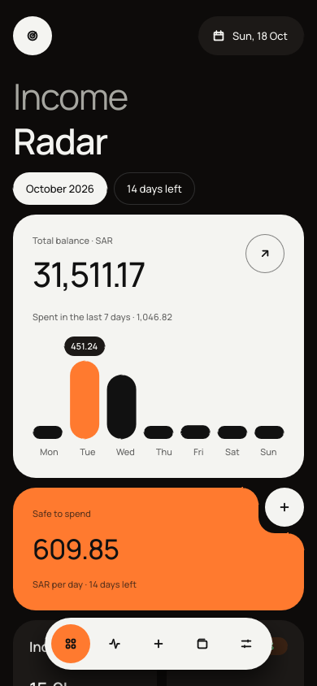
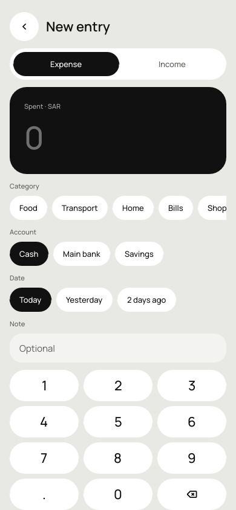
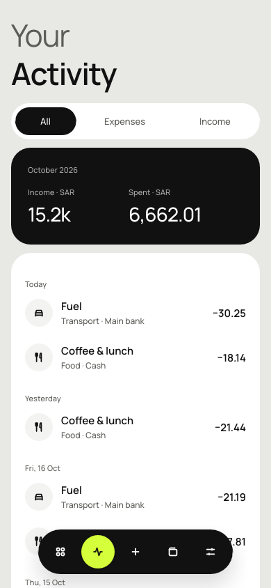
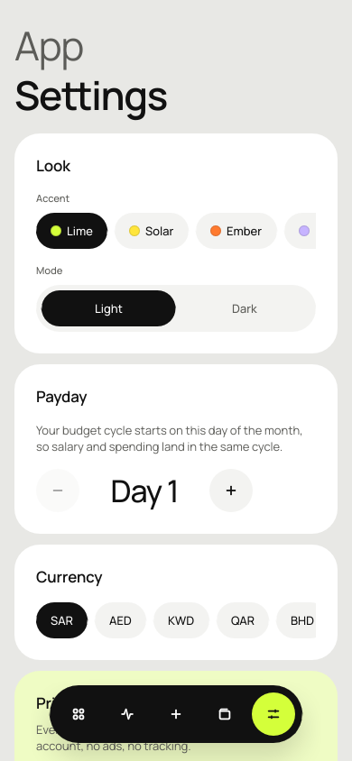

# Income Radar

A lightweight personal-finance app for Android, written in Rust.

* **UI:** [Slint](https://slint.dev) (native, GPU-rendered, no WebView, no JVM UI code)
* **Storage:** SQLite (bundled through `rusqlite`), stored on the device only
* **Design:** Bento Neo design system: 8 themes (Lime, Solar, Ember, Lilac × light/dark), Manrope font
* **APK size:** about 7 MB (single arm64 `.so`, release profile with LTO and `opt-level = "s"`)

| Home | Home (scrolled) | Ember dark | New entry | Activity | Settings |
|---|---|---|---|---|---|
|  |  |  |  |  |  |

## What it does

* **Radar dashboard:** total balance, spending over the last 7 days, *safe to spend per day*
  until the end of the cycle, income and spending against the previous cycle, savings rate,
  projected spending at the current pace, and where the money goes.
* **Payday cycles:** the budget month starts on your payday (day 1–28), so a salary paid on the
  27th lands in the cycle it pays for.
* **Fast entry:** built-in keypad, category and account chips, today / yesterday / 2 days ago.
* **Accounts:** cash, bank, card and savings accounts. Balances are calculated from the ledger
  (opening balance + entries + transfers), never stored, so they cannot drift.
* **Money as integers:** amounts are stored in minor units (`i64`), not floating point.
  Input accepts Arabic-Indic digits.
* **Private:** no account, no network permission, no ads.

## Layout

```
crates/core/   domain logic, no UI (money, cycles, SQLite store, radar analytics) + tests
app/           Slint UI and the Android / desktop entry points
  ui/theme.slint            Bento Neo tokens (all 8 themes, spacing, radii, type scale, icons)
  ui/components/bento.slint Tile, NotchCard, PillButton, IconButton, Chip, Badge, Progress,
                            Bars, ListRow, PillNav, Dock, Field
  ui/screens/               home, activity, add, accounts, settings
  src/lib.rs                UI ↔ store glue, `android_main`
  src/main.rs               desktop window and `--screenshots` mode
  android/res/              launcher icon
```

## Build

### Desktop (for development)

```sh
cargo run -p income-radar
cargo test --workspace
```

Linux needs the usual X11/Wayland libraries (`libxkbcommon-x11`, `libfontconfig`).

Screenshots of every screen, using sample data and a fixed date:

```sh
INCOME_RADAR_TODAY=2026-10-18 cargo run -p income-radar -- --screenshots docs/screenshots
```

### Android APK

Requirements: Android SDK (platform 35, build-tools 35), NDK r28, Java 17+, and

```sh
rustup target add aarch64-linux-android
cargo install cargo-apk
export ANDROID_HOME=/path/to/android-sdk
export ANDROID_NDK_ROOT=$ANDROID_HOME/ndk/28.2.13676358
```

Debug build, installed on a connected phone:

```sh
cargo apk run -p income-radar --lib
```

Release build. Use your own keystore and keep it out of the repository:

```sh
export CARGO_APK_RELEASE_KEYSTORE=/path/to/release.jks
export CARGO_APK_RELEASE_KEYSTORE_PASSWORD=...
cargo apk build -p income-radar --lib --release
# → target/release/apk/income-radar.apk
```

## Roadmap

* Arabic UI with right-to-left layout (needs an Arabic font paired with Manrope)
* Edit entries, transfers between accounts in the UI, budgets per category
* Recurring entries and subscription reminders
* Encrypted backup / export (CSV, XLSX)
* Home-screen widget for quick entry

## Fonts

Manrope is licensed under the SIL Open Font License (`app/fonts/OFL.txt`).
